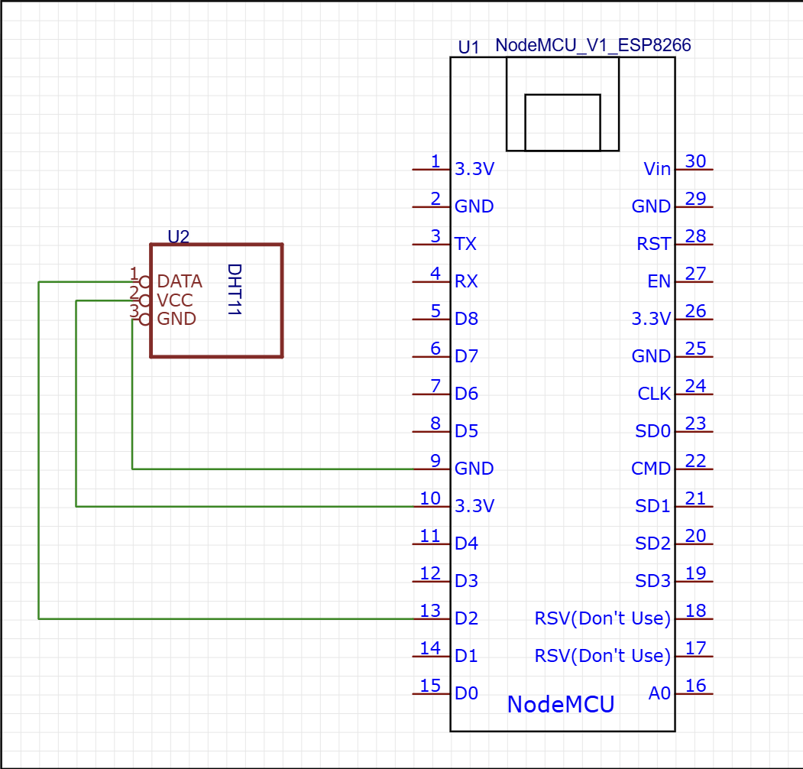

# 🌡️ ESP8266 Environmental Monitor with Telegram Alerts & Adafruit IO

An IoT-based environmental monitoring system powered by a **NodeMCU ESP8266** and a **DHT11 sensor**. The system logs ambient temperature and humidity to **Adafruit IO** every 10 seconds and sends instant high-priority **Telegram alerts** whenever rapid temperature spikes or absolute thresholds are reached.

---

## 📌 Features

* **Real-time Cloud Logging:** Publishes temperature and humidity data directly to Adafruit IO feeds.
* **Rapid Spike Detection:** Pushes an alert to Telegram if temperature rises by $\ge 1.5^\circ\text{C}$ within a 10-second sampling window.
* **Absolute Threshold Warnings:** Triggers Telegram alerts if temperature exceeds $35.0^\circ\text{C}$.
* **Secure Credentials Architecture:** Sensitive keys (Wi-Fi credentials, Adafruit IO keys, and Telegram Bot tokens) are isolated in `include/config.h` and protected via `.gitignore`.
* **Resilient SSL & Wi-Fi Management:** Features automatic flash memory cleanup (`WiFi.persistent(false)`) to resolve connection timeouts and re-arms SSL sessions before Telegram API requests.

---

## 📸 Screenshots & Alerts

*(Upload your Telegram alert screenshots here after testing)*

| Telegram Startup Notification | Rapid Spike Alert |
| :---: | :---: |
| *[ Insert Startup Screenshot ]* | *[ Insert Alert Screenshot ]* |

---
## 🔌 Circuit Diagram & Hardware Setup

Here is the complete schematic diagram for connecting the NodeMCU ESP8266 to the DHT11 sensor and status indicator:



## 🔌 Circuit Wiring & Hardware Setup

*(Upload your circuit diagram or physical connection photo here)*

| Component Pin | NodeMCU ESP8266 Pin | Notes |
| :--- | :--- | :--- |
| **DHT11 VCC** | 3V3 / 5V | Power Input |
| **DHT11 DATA** | **D2** (GPIO4) | Data Signal Line |
| **DHT11 GND** | GND | Common Ground |


---

## 🛠️ Project Structure

```text
esp32-dht-cloud-logger/
├── README.md              # Project documentation (Root level for GitHub display)
├── ESP8266_Cloud_Monitor/ # PlatformIO Project Folder
    ├── platformio.ini     # Hardware and library dependencies
    ├── include/
    │   ├── config.h       # YOUR PRIVATE KEYS (Git-ignored)
    │   └── config.example.h # Public template for configuration
    └── src/
        └── main.cpp       # Main application logic